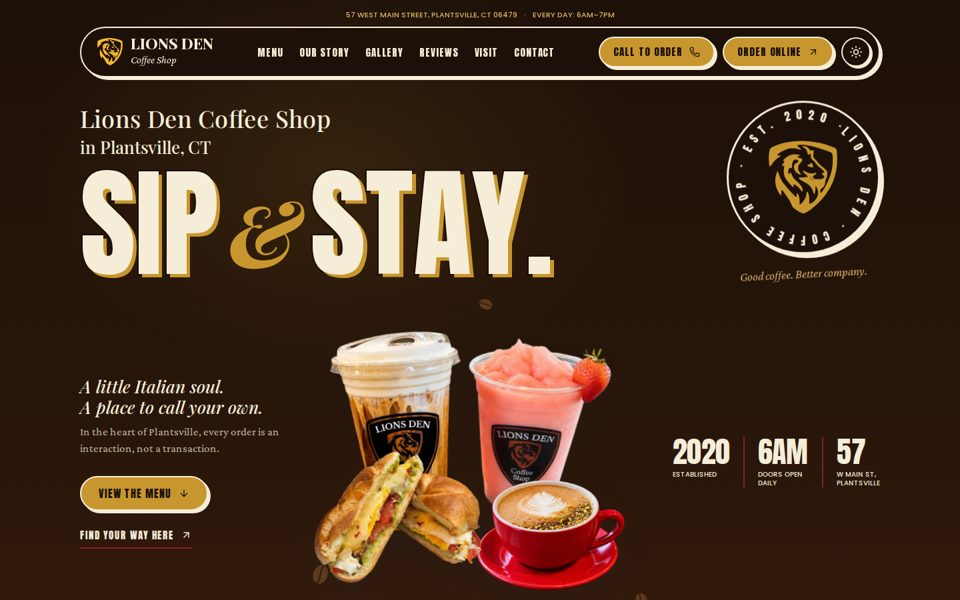
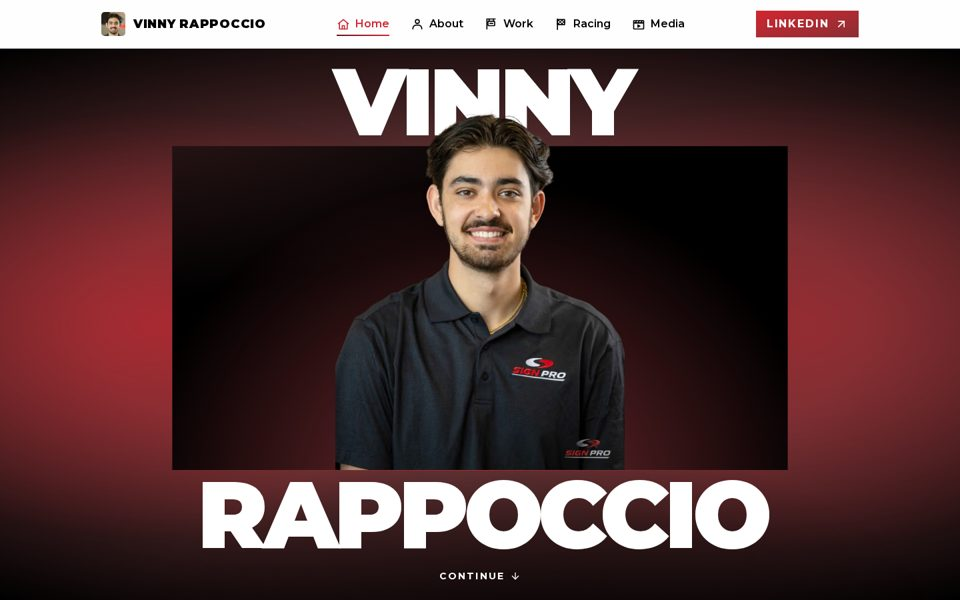
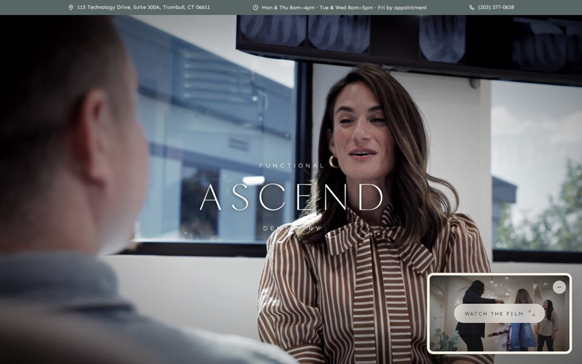
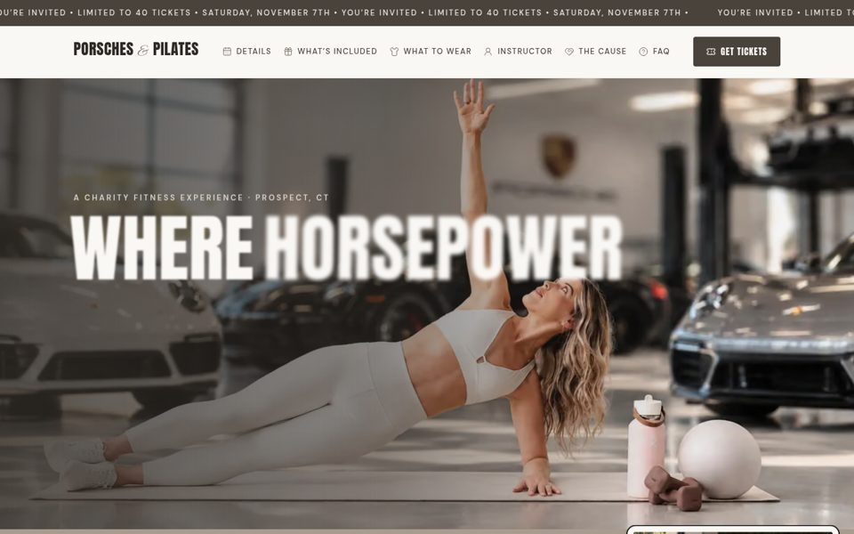
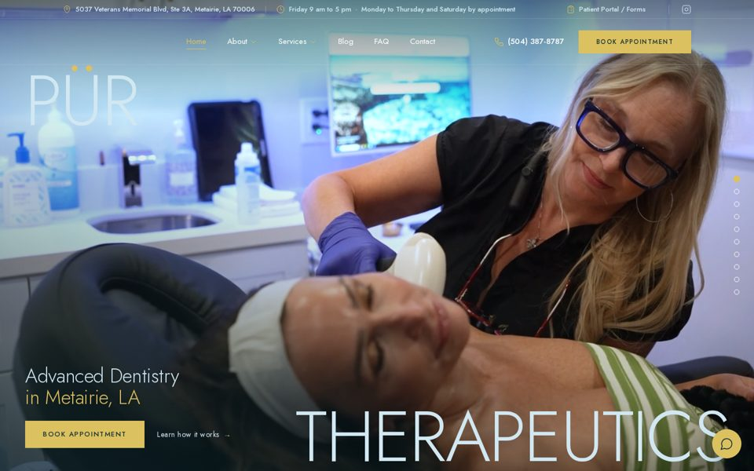
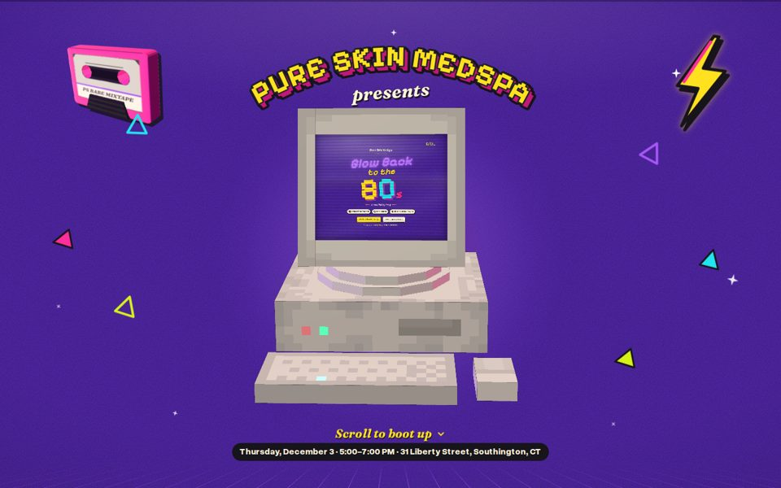
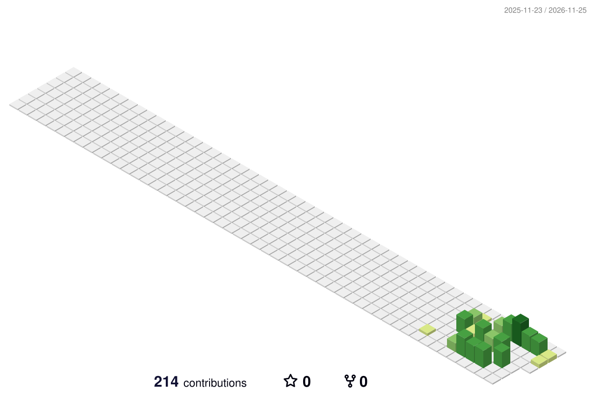

<h1 align="center">Hi, I'm Damion</h1>

  

  I build fast, modern websites for local businesses at <a href="https://github.com/Develomark-Agency"><b>@Develomark-Agency</b></a>.

  

### What I work on

- &nbsp;Marketing sites for dental practices, skincare and wellness brands, studios, and cafés
- &nbsp;Performance-first builds: Lighthouse-tested, image-optimized, and SEO-ready with structured data
- &nbsp;Smooth motion and interaction with GSAP, Motion, and Lenis
- &nbsp;Analytics and measurement wired in from day one

### Recent work

<!-- PORTFOLIO:START -->
<table>
  <tr>
    <td width="50%" valign="top">
      
       <b><a href="https://www.lionsdencoffeeshop.com">Lions Den Coffee Shop</a></b>
       Italian coffee shop in Southington, CT, on a custom CMS
       
      
      
      
      
    </td>
    <td width="50%" valign="top">
      
       <b><a href="https://www.vincentrappoccio.com">Vincent Rappoccio</a></b>
       Personal brand site for a marketer and race car driver
       
      
      
      
      
    </td>
  </tr>
  <tr>
    <td width="50%" valign="top">
      
       <b><a href="https://ascendfunctionaldentistry.vercel.app">Ascend Functional Dentistry</a></b>
       Biological and functional dentistry in Trumbull, CT
       
      
      
      
      
    </td>
    <td width="50%" valign="top">
      
       <b><a href="https://www.porschespilates.com">Porsches & Pilates</a></b>
       Event site for a charity cars-and-Pilates morning in Prospect, CT
       
      
      
      
      
    </td>
  </tr>
  <tr>
    <td width="50%" valign="top">
      
       <b><a href="https://pur-therapeutics.develomark-clients.workers.dev">Pür Therapeutics</a></b>
       Advanced dentistry and TMJ care in Metairie, LA
       
      
      
      
      
    </td>
    <td width="50%" valign="top">
      
       <b><a href="https://glowback.ctskin.com">Pure Skin: Glow Back to the 80s</a></b>
       Retro holiday party site for a Connecticut med spa
       
      
      
      
      
    </td>
  </tr>
</table>

Lighthouse scores are mobile, median of three runs, refreshed weekly.
<!-- PORTFOLIO:END -->

### Tech stack

  

### Activity

  <picture>
    <source media="(prefers-color-scheme: dark)" srcset="profile-3d-contrib/profile-night-rainbow.svg" />
    
  </picture>

  <picture>
    <source media="(prefers-color-scheme: dark)" srcset="https://streak-stats.demolab.com?user=damion-develomark&theme=github-dark-blue&hide_border=true" />
    
  </picture>

  <picture>
    <source media="(prefers-color-scheme: dark)" srcset="https://raw.githubusercontent.com/damion-develomark/damion-develomark/output/github-snake-dark.svg" />
    
  </picture>

